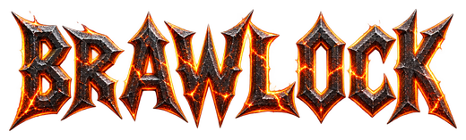
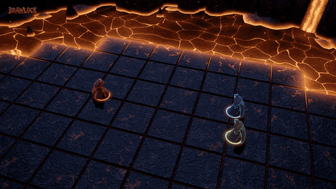
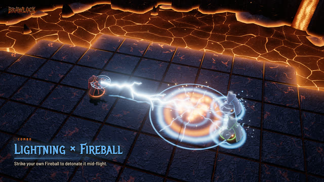
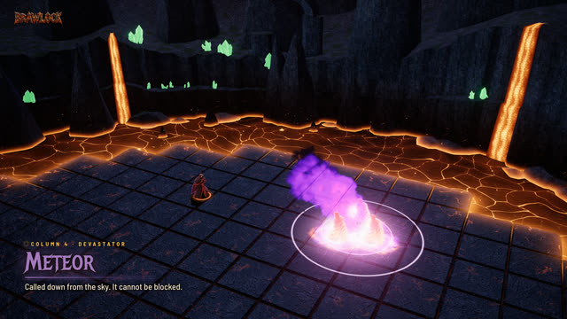
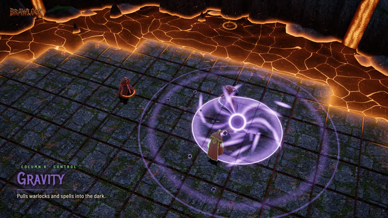
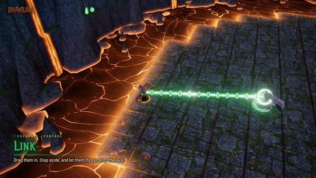
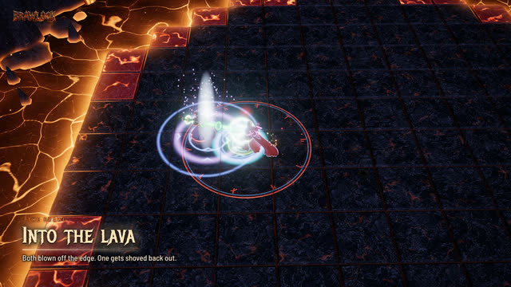
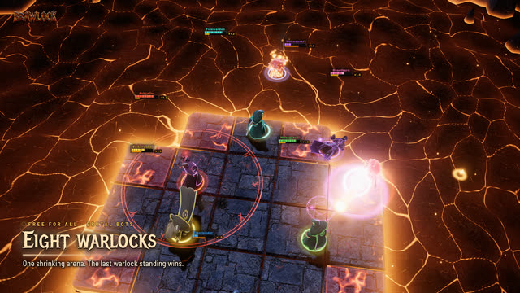

<p align="center">
  
</p>

<p align="center">
  <b>Knock the other warlocks into the lava.</b><br>
  Warlock Brawl, rebuilt for the browser. Open a link, play.
</p>

<p align="center">
  <a href="https://laubsauger.github.io/brawlock/"><b>Play now</b></a>
</p>

<p align="center">
  
</p>

## How it plays

- Right-click to move, press a key to cast at the cursor.
- Hits push you around. The more damage you take, the farther the next hit throws you.
- The arena shrinks. Last warlock standing takes the round.
- Between rounds you buy and level up spells: 24 of them, plus items.

<table>
  <tr>
    <td></td>
    <td></td>
    <td></td>
  </tr>
  <tr>
    <td></td>
    <td></td>
    <td></td>
  </tr>
</table>

## Play with friends

Host a lobby and send the 5-letter code. Peer-to-peer, up to 10 players. Add bots to fill empty slots.

## Run it yourself

```sh
npm install
npm run dev
```

three.js (WebGPU, WebGL2 fallback), React, PeerJS. Game rules and numbers live in [`docs/PLAN.md`](docs/PLAN.md).

---

<sub>A fan remake of Warlock (Warcraft III) and Warlock Brawl (Dota 2). Not affiliated with either. Mechanics are re-implemented from scratch; no original code or art is used. Asset credits are in the game.</sub>
